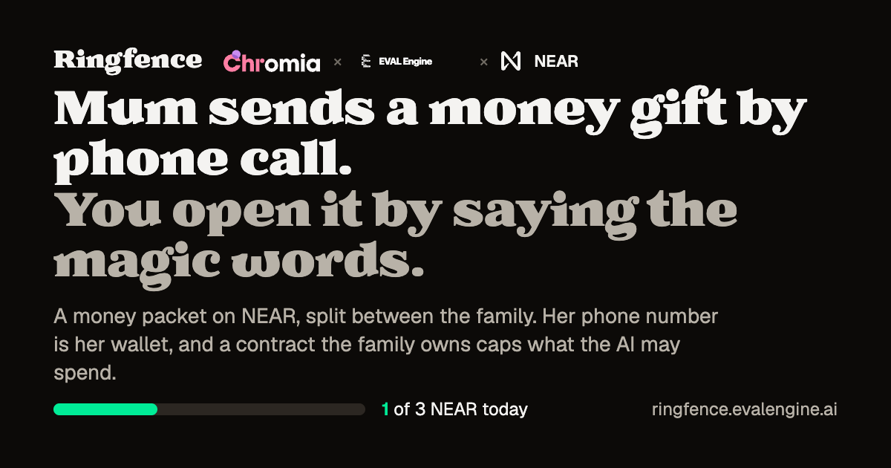

# Ringfence



**Mum can make a phone call. She doesn't know how to use Meteor Wallet.**

Ringfence lets her pay by voice: she calls from WhatsApp or the browser, says "send 0.1 NEAR to liho.near", hears it read back, confirms, and it's sent. What the AI is allowed to spend is capped by a NEAR contract the family owns, not by the AI.

Site: **https://ringfence.evalengine.ai** · Code: **github.com/ChromiaAgents/ringfence** · Made by Chromia x evalengine x NEAR

> **Honest status.** Mainnet signing is pending: no transfer has been signed on chain yet. Every send in the hosted demo is a clearly labelled **DRY RUN**. Links will go in [Mainnet evidence](#mainnet-evidence) as soon as they exist.

## Try it (2 minutes)

1. **Browser call (start here).** Open https://ringfence.evalengine.ai, press **Call**, allow the mic (or type into the call box). Say "send 0.1 NEAR to liho.near", listen to the read back, say any 4-digit PIN. You get a DRY RUN result. Then ask "what's my balance?" or try to break it ("send 50 NEAR", "send to a new account").
2. **Proof page.** Open https://ringfence.evalengine.ai/proof: the live, verified TEE attestation of the three models.
3. **WhatsApp (caveat).** The line runs on Meta's free test number, which only replies to 5 pre-approved numbers, so judges most likely can't use it. Everything WhatsApp does is also reachable through the browser call, except the Approve button, which is shown in the demo video.
4. **No network, no keys:** `npm ci && npm test && npm run demo:check` (see [Run locally](#run-locally)).

## How the safety works

The AI only asks. The contract the family owns decides.

- **Contract limits.** Each phone number maps to its own NEAR contract (`contracts/phone-wallet`), owned by the person or a family guardian. It enforces a per-transfer and per-day limit, a saved-recipients list, a 600-second wait for new recipients, and owner-only `withdraw` and `revoke_agent`. The agent key the server holds can only call this contract, and only inside these limits.
- **Three confirmation tiers.**

  | Send | How it is confirmed |
  | --- | --- |
  | Up to 0.2 NEAR to a saved recipient | Spoken 4-digit PIN (salted scrypt hash, 3 tries then a 15-minute lock, blanked from transcripts and logs) |
  | Above 0.2 NEAR, still within the contract's limits | An **Approve / Cancel / Not me** tap in WhatsApp on the wallet's bound phone (single use, expires in 120 s) |
  | Over a limit, or to a new recipient | The AI doesn't send. It texts a link and you sign it yourself in your own wallet |

- **One agent with tools.** One AI agent decides every reply and action. Its tools (`get_balance`, `prepare_transfer`, `confirm_transfer`, `end_call`, ...) dispatch to plain code that enforces the PIN, the tiers and the approvals. The safety is in that code and in the contract, not in the prompt, so a confused or tricked model can at most ask for a transfer inside the limits.
- **Private AI with proof.** All three models (speech-to-text, chat, image generation) run on NEAR AI Cloud inside trusted execution environments (Intel TDX + NVIDIA confidential GPUs). The server verifies the attestation itself, and `/proof` shows it live. Every chat reply's signature is checked against the attested key.
- **Worst case, even if the operator is malicious:** the contract's daily cap (3 NEAR by default on mainnet), only to saved recipients, and the owner ends it with one `revoke_agent` transaction. Or hold the agent key yourself: [SELF-HOST.md](SELF-HOST.md).

## Status, honestly

| Part | State |
| --- | --- |
| Voice agent, tools, tiers, PIN, WhatsApp Approve | Built and tested offline (`npm test`, `npm run demo:check`) |
| Phone-wallet contract | 23 unit tests + a near-workspaces sandbox test. **Unaudited**: keep small amounts |
| TEE attestation of 3 models | Verified live (`npm run attest`, `/proof`) |
| Mainnet signing | **Pending.** Sends are a labelled dry run until the agent key and factory are deployed |
| EVM sends via Chain Signatures | Built, off unless `EVM_ENABLED=1`; not part of the pitch |

## Mainnet evidence

<!-- TODO: fill after the first mainnet transactions. Do not invent links. -->

| What | Link |
| --- | --- |
| Factory `ringfence-wallet.near` + phone-wallet global contract deployed | TODO: nearblocks link |
| A phone wallet created via `/wallet/bind` (`create_wallet`) | TODO: nearblocks link |
| First voice send, 0.1 NEAR to liho.near with spoken PIN (`transfer_near`) | TODO: nearblocks link |
| An over-limit send refused by the contract or handed to self-sign | TODO: nearblocks link or screenshot |
| Demo video | TODO |

## Architecture

```
 WhatsApp call/text ─┐                         ┌─ NEAR AI Cloud (TEE): speech-to-text, chat, image generation
 Browser call (WS) ──┼─> server.ts (one Node) ─┤      attestation verified in-process, shown on /proof
                     │   one agent + tools     └─ NEAR RPC: user's phone-wallet contract
                     │   PIN / tiers / approvals in code      (limits, saved recipients, owner revoke)
                     └─ /wallet/bind, /wallet/send: signed by the user in their own wallet (Wallet Selector)
```

- `src/agent.ts`: the one agent, its tool loop and per-sentence output filter.
- `src/desks/wallet.ts`, `src/wallet.ts`: wallet tools, PIN, tiers, agent-key calls.
- `contracts/phone-wallet`: the Rust contract that enforces the limits.
- `src/ai.ts`: NEAR AI Cloud chat and STT, signature checks, attestation verifier, `MOCK_LLM` script.
- `src/whatsapp.ts`, `src/voice.ts`: WhatsApp calls (WebRTC/Opus) and messages; the browser call.
- `app/`: TanStack Start UI (`/`, `/wallet/*`, `/dashboard`, `/proof`).

## Run locally

Node 22+. No `.env`, key, wallet or network needed.

```bash
npm ci
npm test              # offline except the address derivation check
npm run typecheck
npm run build
npm run demo:check    # starts the built server with MOCK_LLM=1, walks a wallet send (DRY RUN), the Approve tier, an off-topic decline, a refused EVM send, and checks the pages
```

Click through it yourself: `MOCK_LLM=1 TTS=off npm start`, open http://localhost:8787, press **Call**, type `send 0.1 NEAR to liho.testnet`, then a 4-digit PIN. In mock mode a keyword script (`mockStep` in `src/ai.ts`) stands in for the model; the tools, rules, pages and ledger are the real ones.

With network, no key: `npm run attest` verifies the TEE attestation of all three models.

With keys: `cp .env.example .env` (at least `NEARAI_API_KEY`; `NETWORK=testnet` by default), then `npm run dev`. Production: `deploy/README.md`. Your own operator: [SELF-HOST.md](SELF-HOST.md).

---

# Details for reviewers

## Feature → where in the code → how to verify

| Feature | Code | Verify |
| --- | --- | --- |
| Phone wallet contract: per-transfer and per-day limits per asset, EVM chain allowlist, recipient allowlist, 600 s delay for new recipients, owner-only `withdraw` / `revoke_agent` / `set_agent`, agent never the owner | `contracts/phone-wallet/src/lib.rs` | Contract unit tests (23) and the near-workspaces sandbox test; read `lib.rs` |
| Contract parses the unsigned EIP-1559 bytes (chain id, to, value) before asking the MPC signer | `lib.rs` `parse_eip1559`; `src/eth.ts` `buildTransfer` | Contract tests (RLP, chain id mismatch, Base vector); `npm test` (Sepolia and Base bytes match the contract's vectors) |
| Same EVM address on every EVM chain through Chain Signatures, derived as NEAR's MPC does | `src/eth.ts` `deriveEthAddress`; `src/chains.ts` | `npm test` (compares with live `derived_public_key` views of `v1.signer` and `v1.signer-prod.testnet`) |
| Gas checked before signing; says how much is missing and where to fund | `src/eth.ts` `prepareTransfer`, `GasShortError` | `npm test` (mocked RPC) |
| Voice send: read back, spoken PIN (salted scrypt hash, 3 tries then 15 min lock, blanked from transcript and tool log) | `src/desks/wallet.ts`; `src/wallet.ts` `hashPin`, `checkPin`, `normalizePin` | `npm test`; `npm run demo:check` (wallet step, DRY RUN) |
| Real NEAR and Base transfers with the agent key | `src/wallet.ts` `sendNear`, `sendEvm`; `app/routes/wallet.bind.tsx`, `app/routes/wallet.send.tsx` | Needs `AGENT_ACCOUNT_ID`, `AGENT_PRIVATE_KEY`, `NETWORK=mainnet`, a bound number. Not run live yet |
| Ticker/name impersonation refused (blocked list) | `src/desks/launch.ts` `checkTicker`, `checkName`; `launchpad.yaml` | `npm test` (ticker impersonation, name impersonation); `npm run demo:check` step 2 |
| No promised returns: replies filtered sentence by sentence before they are spoken | `filterClaims`, `src/speech.ts` `sentenceSplitter` | `npm test` (no promised returns, streamed sentences + per-sentence filter) |
| All rules re-checked at the last step; kill switch | `prepare_launch` in `src/desks/launch.ts` | `npm test` (justhoot prepare_launch); set `kill_switch: true` in `launchpad.yaml` and walk the demo |
| JustHoot `launch_meme` (token + RHEA pool in one call), cost from the contract's views | `src/justhoot.ts` | `npm test` (justhoot args, justhoot prepare_launch); `npm run test:justhoot` (mainnet views) |
| Wallet Selector: Meteor, HOT, Intear, MyNearWallet; server never signs | `app/routes/launch.$id.tsx` | Open a launch page, **Connect a wallet** |
| One agent (all tools, dispatch to desk code, end_call) and returning-caller memory | `src/agent.ts` `toolsFor` / `deskOfTool`; `src/memory.ts` | `npm test` (one agent, returning caller) |
| TEE attestation: Intel TDX quote signature + TCB status, key+nonce in report_data, NVIDIA GPUs via NRAS | `src/ai.ts` `attest`, `verifyIntelQuote`, `verifyGpu` | `npm run attest` (no key); `/proof`; `/api/proof?fresh=1` |
| Every chat reply's signature recovered and matched to the attested key (built; live check pending) | `src/ai.ts` `chat`, `verifyLater` | Needs `NEARAI_API_KEY`: call, then see **TEE-signed** badges on `/dashboard` |
| Voice: TTS (Cartesia Sonic in the cloud, or local Kokoro), Whisper STT in a TEE, barge-in, fillers | `src/tts.ts`, `src/turn.ts`, `src/voice.ts` | `MOCK_LLM=1 npm run test:latency`; a browser call |
| WhatsApp calls (WebRTC/Opus), text (photos get a polite "can't use photos") | `src/whatsapp.ts` | Needs Meta test number, see [WhatsApp setup](#whatsapp-setup-metas-free-test-number) |
| Ledger of every refusal, filter hit, launch and wallet action | `src/store.ts` `log`; `/dashboard` | `npm run demo:check` step 6 |

## Phone wallet: your phone number is a NEAR wallet

> **Unaudited prototype: keep small amounts.** The phone-wallet contract has not been audited. On mainnet it moves real money; the defaults are deliberately small.

Bind your NEAR account (`.near` on mainnet, `.testnet` on testnet, per `NETWORK`) to your WhatsApp number once on `/wallet/bind`. Then on a call: "send 0.1 NEAR to liho.near", hear it read back ("0.1 NEAR to liho dot near"), say your 4-digit PIN, and it executes on chain within limits a smart contract enforces, not the AI. The nearblocks link arrives on WhatsApp. (With `EVM_ENABLED=1` the same flow also takes "send 0.0001 ETH on Base to 0x…"; off by default.)

**How it works**

1. `/wallet/bind`: connect your NEAR wallet (or follow "No wallet? Create one in Meteor"), get a 6-digit code on WhatsApp, set a PIN (stored only as a salted scrypt hash), edit the limits, then sign one plain function call: `create_wallet(phone_hash, owner = you, agent, near_limit, new_recipient_delay_sec)` on the factory (`FACTORY_ACCOUNT_ID`, ringfence-wallet.near), attaching 0.013 NEAR. It creates `<12 hex>.ringfence-wallet.near` on the phone-wallet global contract. Works in any wallet, including implicit accounts. **Guardian option**: "Set up for someone else" makes your wallet the owner and your family member's WhatsApp the phone; the code goes to their phone and they read it out. Nothing runs until you sign.
   - **No wallet at all (built, dry run until keys are set):** text "create a wallet" to the WhatsApp number. The agent explains it's a demo custodial wallet (capped, unaudited), you reply with a 4-digit PIN (answered outside the agent, never logged), and the server calls `create_wallet` with owner = `CUSTODY_ACCOUNT_ID`. Without `CUSTODY_PRIVATE_KEY` this is a labelled DRY RUN. Caps: spends stop above `CUSTODIAL_MAX_NEAR` (5) NEAR, at most `CUSTODIAL_DAILY_CAP` (20) wallets a day.
   - **Claim (built, not run on chain):** `/wallet/claim`: connect your wallet, verify a WhatsApp code to the bound number; custody calls `propose_owner(you)`, you sign `accept_owner`. After that the server marks the wallet non-custodial and never uses the custody key on it.
2. On a call the agent uses the **wallet tools** (`src/desks/wallet.ts`) when the caller wants to pay: `get_balance`, `prepare_transfer({to, amount, asset})` (reads back), `confirm_transfer({pin})`. `asset` is `near` or a chain name (`base`, `ethereum`, `arbitrum`, `optimism`, `polygon`, `bnb`, `avalanche`); plain "ETH" gets "which chain?". The PIN is checked against the hash; 3 wrong tries lock it for 15 minutes; the PIN is blanked from the stored transcript and the tool log.
3. With the PIN right, the server calls your contract with the agent key (`near-api-js`): `transfer_near` for NEAR, `request_signature` for EVM chains.
4. **Confirmation tiers (built, tested offline):** up to `SMALL_LIMIT` (0.2 NEAR) to a saved recipient: spoken PIN. Larger, still within limits: a WhatsApp interactive message with [Approve] [Cancel] [Not me] goes to the wallet's bound phone (amount, recipient, daily limit left; single use, expires in 120 s), also for browser calls; on Approve the server executes and the agent on the call says so. Cancel just drops it. Not me pauses all spends from that wallet on the server for 15 minutes (owner-only `freeze` is not available to the agent key) and, for a custodial wallet, also calls `freeze` on chain with the custody key. Over a limit or to a new recipient: the agent texts a link (`/wallet/send`) to sign it in your own wallet. With the default 1 NEAR per-transfer limit, sends above 0.2 NEAR use the Approve tier.
5. "How much did I spend?": today's spend vs the daily limit from the contract, and the last 5 transfers from the ledger.
6. A number with no wallet gets the choice: a demo custodial wallet in chat, or `/wallet/bind`.

**EVM chains through Chain Signatures (built, off unless `EVM_ENABLED=1`).** One MPC path (`ethereum-1`) gives your contract **the same EVM address on every EVM chain**; you fund gas on whichever chain you want to use. The address is derived as NEAR's MPC does (`src/eth.ts`; checked in `npm test` against the live `derived_public_key` views of both `v1.signer` (mainnet) and `v1.signer-prod.testnet`). Chains come from a small registry (`src/chains.ts`: Ethereum 1, Base 8453, Arbitrum 42161, Optimism 10, Polygon 137, BNB Chain 56, Avalanche 43114, plus Sepolia; more with `EXTRA_CHAINS`, RPCs overridable with `RPC_<chainId>`). The server builds an EIP-1559 transfer (nonce and fees from the chain's public RPC) and **checks gas first**: if the address holds less than value + maxFee × 21000, it says how much is missing and which address to fund, and no signature is requested. The contract parses the unsigned transaction itself (minimal RLP: the chain id must be on the owner's chain allowlist and match `evm:<chainId>`, `to` an address, no calldata, no access list), applies that chain's limits to the value it parsed, and calls `sign({request: {path, payload_v2: {Ecdsa: keccak256(tx)}, domain_id: 0}})` on the MPC signer with 1 yoctoNEAR. The signature comes back as the call's result; the server attaches it and broadcasts to that chain.

**Which chains are on (only with `EVM_ENABLED=1`).** Mainnet: **Base** is enabled at bind with small limits. The other registry chains are known to the server but the contract refuses them until the owner allows them, with their own limits in that chain's native units (wei for ETH, BNB, POL, AVAX):

```bash
near contract call-function as-transaction phone.you.near allow_chain json-args '{"chain_id":42161,"per_tx":"500000000000000","per_day":"2000000000000000"}' prepaid-gas '30 Tgas' attached-deposit '1 yoctoNEAR' sign-as alice.near network-config mainnet sign-with-keychain send
```

Next: non-EVM chains (Bitcoin, Solana through the same MPC signer's other domains) are not supported yet.

**Trust model and limits.** The contract is the only thing that can move funds, and it checks every agent call. **It is an unaudited prototype: keep small amounts in it.**

| Rule | Enforced in `contracts/phone-wallet/src/lib.rs` |
| --- | --- |
| Per transfer and per day, per asset (`near`, `evm:<chainId>`) | Mainnet defaults 1 / 3 NEAR (`WALLET_NEAR_PER_TX`, `WALLET_NEAR_PER_DAY`) and 0.0005 / 0.002 per EVM chain (native units); editable on the bind page before signing; owner changes later with `set_limits`. Over → panic with the reason |
| EVM chains on an owner allowlist | `allow_chain(chain_id, per_tx, per_day)` / `disallow_chain`; a chain not allowed, or without a limit, is refused; the tx's chain id must match |
| Saved recipients go instantly; new ones queue (the voice agent hands them to you to self-sign instead) | `new_recipient_delay_sec` = 600; `execute(id)` after the delay, owner `cancel(id)` before |
| Owner keeps full control | `withdraw(amount)` always works (the agent can't block it), `set_agent`, `revoke_agent`, `allow`/`disallow`, `allow_chain`/`disallow_chain`, `set_delay`; all need 1 yoctoNEAR so a dapp's function-call key can't call them |
| The agent is never the owner | checked at init and in `set_agent` |
| EVM chain, value and recipient are the ones signed | parsed from the transaction bytes the contract hashes and sends to the signer |
| A phone can't borrow someone else's contract | the owner signs `phone_hash` at init; the server checks it before every call |

What the AI can do if it goes wrong: ask the contract for transfers inside your limits to your saved recipients after a correct PIN. What the server operator could do with the agent key: the same, without the PIN (the PIN protects against someone else calling from a spoofed or stolen line, not against us). Your cap on that is the daily limit per asset; `revoke_agent` ends it.

**Verified and not.** Verified locally: 23 contract unit tests (limits, mainnet defaults, day rollover with mocked time, allowlist vs delay queue, cancel, owner-only methods, revoke, RLP parsing, chain allowlist, chain id mismatch, chain without limit, Base tx vector) and a near-workspaces sandbox test (real transfers, the delay with fast-forward, owner withdraw while the agent is set, agent locked out of owner methods and after revoke, `request_signature` for Sepolia and Base routed to a mock MPC signer with the wallet as predecessor and the right request shape, a non-allowed chain refused); `npm test` (PIN normalization, lockout, intent → tool args incl. "on Base", chain registry, ETH derivation against the live mainnet and testnet MPC views, Sepolia and Base EIP-1559 bytes identical to the contract's test vectors, the gas-check refusal with a mocked RPC, signature assembly); `demo:check` walks "send 1 NEAR to liho.testnet" + PIN to a clearly labelled **DRY RUN**. Not verified: nothing has been deployed or sent on mainnet, testnet, Base or Sepolia; the real MPC signer's response going through `getTransactionLastResult`; which wallets accept the create + deploy + init transaction on `/wallet/bind` (CLI fallback in HANDOVER.md); a queued EVM transfer can go stale (its nonce and fees are fixed when queued); the public RPCs' rate limits. `ft_transfer` and ERC-20s are not implemented.

`AGENT_ACCOUNT_ID` / `AGENT_PRIVATE_KEY` turn it on; without them it is a dry run.

## TEE attestation, in detail

`npm run attest` (network only, no key) fetches `https://cloud-api.near.ai/v1/attestation/report` for each model with a fresh 32-byte nonce and checks:

1. **Intel TDX quote**: signature, QE report and PCK certificate chain up to Intel's SGX root CA, with collateral (TCB info, QE identity, CRLs) fetched from Intel PCS (`api.trustedservices.intel.com`), using [`@phala/dcap-qvl`](https://github.com/Phala-Network/dcap-qvl) (pure JS). Prints the TCB status (for example `UpToDate`) and any advisory IDs. A quote with one flipped byte is rejected ("ISV enclave report signature is invalid").
2. **report_data** (read from the verified quote) equals the model's signing address, zero-padded to 32 bytes, followed by our nonce.
3. **NVIDIA GPUs**: `nvidia_payload` (8 × H100 evidence carrying our nonce) is posted to NVIDIA NRAS `/v3/attest/gpu`; the returned platform and per-GPU JWTs are verified (ES384) against NVIDIA's JWKS, and the overall result, each GPU's measurement result and nonce match must be true.

Output on 2026-11-08 (abridged): every model `PASS` on all three checks, TCB `UpToDate`, `8 x HOPPER`, all models fully verified. The same results are on `/proof` (public) and `/dashboard`, and chat replies only get the **TEE-signed** badge when their signer is a key that passed checks 1 and 2.

Not checked: that the TD measurements (MRTD, RTMR0-3) and the event log match a published, reproducible NEAR AI image, and the `gateway_attestation` of NEAR AI's gateway. For those, follow [docs.near.ai/cloud/verification](https://docs.near.ai/cloud/verification/).

## Environment


| Variable | What it is |
| --- | --- |
| `NEARAI_API_KEY` | NEAR AI Cloud key. Needed for chat, speech-to-text and image generation. Attestation works without it |
| `MOCK_LLM` | `1`: scripted model with tool calls, fake STT; no key needed |
| `TTS` | `off`: text only, no voice at all |
| `TTS_PROVIDER` | `cartesia` (default when `CARTESIA_API_KEY` is set) or `kokoro` (local). With cartesia the reply text goes to Cartesia; Kokoro is not loaded unless `TTS_FALLBACK=kokoro` |
| `CARTESIA_API_KEY`, `CARTESIA_VOICE_ID`, `TTS_SPEED` | Cartesia Sonic (`/tts/bytes`, raw f32 PCM 24 kHz); default voice "Jacqueline" |
| `RTC_PORT_MIN`, `RTC_PORT_MAX` | Fixed UDP range for WhatsApp call audio (e.g. 40000–40100), so a firewall can open it. See `deploy/README.md` |
| `AGENT_ACCOUNT_ID`, `AGENT_PRIVATE_KEY` | Phone wallet agent on `NETWORK`; without them the wallet desk is a dry run |
| `NETWORK` | `testnet` (default) or `mainnet` for launches and the phone wallet |
| `EVM_ENABLED` | Off by default. `1` turns on EVM sends through Chain Signatures (Base on mainnet, Sepolia on testnet); off, the wallet desk says "Only NEAR transfers for now" |
| `PUBLIC_URL` | Public URL of this server, used in launch and wallet links |
| `ONECLICK_JWT` | Optional 1Click partner JWT for launch funding (without it 1Click adds a 0.2% fee) |
| `DASHBOARD_PASSWORD` | Optional basic auth on `/dashboard`, `/api/state` |
| `WHATSAPP_TOKEN`, `WHATSAPP_PHONE_NUMBER_ID`, `WHATSAPP_VERIFY_TOKEN`, `WHATSAPP_APP_SECRET` | WhatsApp Cloud API |


## WhatsApp setup (Meta's free test number)

1. Create an app at developers.facebook.com (type Business), add **WhatsApp**, add your phone as a test recipient.
2. Copy the access token to `WHATSAPP_TOKEN`, the phone number ID to `WHATSAPP_PHONE_NUMBER_ID`, the app secret to `WHATSAPP_APP_SECRET`; pick any `WHATSAPP_VERIFY_TOKEN`.
3. Expose the server (`cloudflared tunnel --url http://localhost:8787`) and set `PUBLIC_URL`.
4. Set the webhook to `<PUBLIC_URL>/webhooks/whatsapp`, subscribe to **messages** and **calls**.
5. In WhatsApp Manager, your number, **Call settings**, allow voice calls.
6. Call or message the number: "I want to launch a memecoin" or "send 0.1 NEAR to alice.testnet".


## Also on the line: coin launches (JustHoot)

The launch desk launches coins on JustHoot:

- **JustHoot** ([justhoot.fun](https://justhoot.fun)): one `launch_meme` call on `v2-launchpad.justhoot.near` creates the token and its RHEA DCL pool (1% fee tier), tradable immediately. **Mainnet only, real NEAR** (there is no testnet deployment), about 0.06 NEAR plus the on-chain logo's storage (about 0.1 NEAR with a 4 KB logo). Deposit and gas come from the contract's `get_launch_deposit` and `get_launch_gas` views; if the signer has no storage on the launchpad, `storage_deposit` goes first in the same transaction. No transfer tax and no dev buy are offered; all supply goes to the creator and the pool. There is no auction and no team share. Tickers are 1 to 10 letters or digits and are not unique on JustHoot. The other rules (blocked tickers and names, return-promise filter, kill switch) apply; pause launches with `kill_switch: true` in `launchpad.yaml`.
- After a JustHoot launch the page links "Give your coin a brain" to [NEARON](https://stg.nearon.dev/#/docs) (stake NEAR, earn CREDIT, bind the coin so its AI agent is paid for). NEARON is a testnet staging prototype today; this is a link only.

Code: `src/justhoot.ts`. Live view-only check: `npm run test:justhoot`. Not verified: no real JustHoot launch has been signed, and the token-id extraction from the launch logs is untested (the page always links the transaction and justhoot.fun).

## Honest limitations

- The phone-wallet contract is unaudited; keep small amounts in it. The operator can spend inside your limits without the PIN. The PIN passes through speech-to-text and the LLM inside NEAR AI TEEs.
- NEAR only for now: EVM sends are built but off unless `EVM_ENABLED=1`. Bitcoin, Solana and ERC-20 tokens are not supported.
- JustHoot is mainnet only and costs real NEAR whatever `NETWORK` says. NEARON is a link only.
- `demo:check` uses a mock model: it proves the tools, rules and pages, not the real model's choices.
- Coin descriptions and links live on our launch page; JustHoot launches go out with no metadata reference.
- No barge-in on WhatsApp calls. The browser call uses a simple energy voice detector.
- Attestation does not compare TD measurements to a published NEAR AI build (see above). Logo generation and speech-to-text have no per-response signature check (NEAR AI signs chat completions).
- Funding a launch from another chain arrives as wNEAR and needs unwrapping before signing; 1Click has no testnet.
- Storage is one JSON file. Photos sent to the line are not read or stored.

## Hackathon disclosures

- **Window (Q-001, Q-003)**: the repository's first commit is 2026-11-07 (`a23758a`), inside the hackathon window (2026-10-19 to 2026-11-14). All code in this repository was written in the window; there is no pre-hackathon baseline.
- **Other chains (Q-002)**: NEAR only for now. EVM sends through NEAR Chain Signatures are built (Base on mainnet, Sepolia on testnet; others only after the owner calls `allow_chain`) but off unless `EVM_ENABLED=1`. The contract and all signing requests live on NEAR. Bitcoin and Solana are not supported.
- **Other projects (Q-015)**: none to disclose.
- **Libraries (Q-005)**: TanStack Start / Router, React, Vite, TypeScript, tsx; `ws` (WebSocket); `werift` and `opusscript` (WebRTC and Opus for WhatsApp calls); `kokoro-js` (local text-to-speech); `ethers` (ECDSA signature recovery for NEAR AI replies); `@phala/dcap-qvl` (Intel TDX quote verification); `@near-wallet-selector/*` (core, modal-ui, Meteor, HOT, Intear, MyNearWallet; the HERE package is installed but not offered); `sharp` (logo resizing); `qrcode`; `yaml`; `@fontsource` fonts. External services: NEAR AI Cloud, NEAR RPC, JustHoot contract, NEAR Intents 1Click, Intel PCS, NVIDIA NRAS, WhatsApp Cloud API. Code was written with AI assistance (Claude Code).

## Credits

Typefaces: **Battlefin** (headings) and **Geist** (body), self-hosted from `/public/fonts`. Placeholder logos are drawn in code.

## Licence

MIT, see `LICENSE`.
